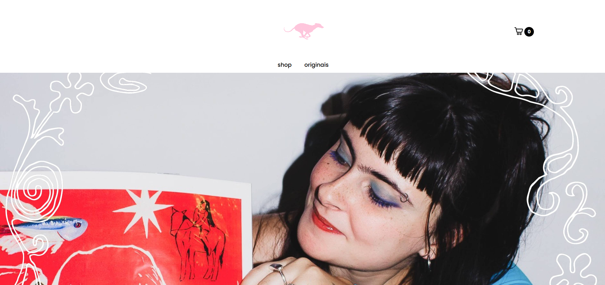
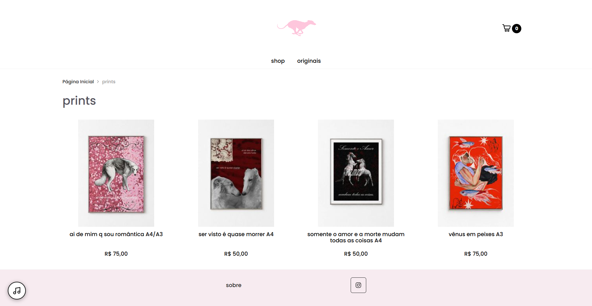
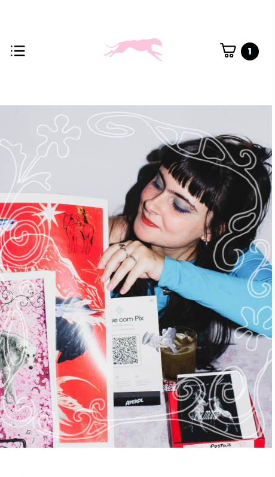
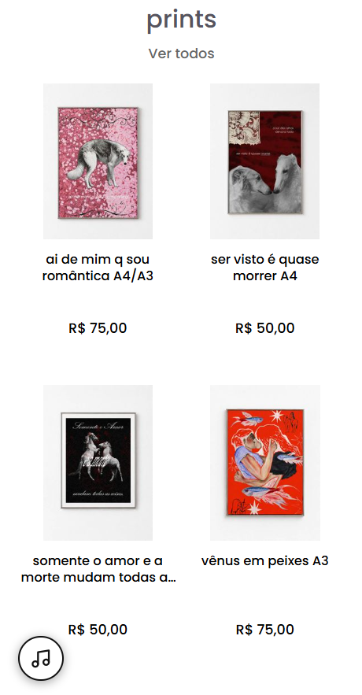

  

# E-commerce | Artista Visual

Projeto de desenvolvimento e personalização de uma loja virtual voltada à comercialização de obras de arte.

A solução utiliza a plataforma **Yampi** como estrutura de e-commerce, com implementação de códigos personalizados para aprimorar a identidade visual, a experiência de navegação e a interação com os visitantes.

## Sobre o projeto

O projeto consiste na construção e personalização de uma loja virtual funcional, com foco na apresentação e comercialização de obras artísticas.

Além da configuração da plataforma, foram desenvolvidos recursos adicionais utilizando HTML, CSS e JavaScript, integrados diretamente à estrutura da loja.

## Funcionalidades implementadas

- Personalização visual da loja utilizando CSS.
- Customização de elementos da interface da Yampi.
- Desenvolvimento de player de música personalizado.
- Reprodução de áudio em loop.
- Botão flutuante para controle da música.
- Integração de JavaScript para interação com o usuário.
- Hospedagem do arquivo de áudio no GitHub.
- Loja virtual publicada e disponível para compras online.

## Tecnologias e ferramentas

| Tecnologia | Aplicação |
|---|---|
| HTML5 | Estrutura dos componentes personalizados |
| CSS3 | Estilização e personalização visual |
| JavaScript | Interatividade e controle do player |
| Yampi | Plataforma de e-commerce |
| GitHub | Versionamento e hospedagem de arquivos |
| GitHub Pages | Disponibilização do arquivo de áudio |

## Player de música

Um dos recursos desenvolvidos foi um player de música personalizado, integrado à loja virtual.

O componente utiliza HTML, CSS e JavaScript e conta com:

- Reprodução de áudio em loop.
- Controle manual de reprodução.
- Botão flutuante com interface minimalista.
- Armazenamento da posição da música durante a navegação.
- Arquivo de áudio hospedado no GitHub Pages.

## E-commerce em funcionamento

A loja foi publicada na internet utilizando a plataforma Yampi, permitindo que visitantes naveguem pelo catálogo, conheçam as obras e realizem compras online.

## Objetivo do projeto

Aplicar conhecimentos de desenvolvimento web na personalização de uma plataforma de e-commerce existente, explorando integração de tecnologias, experiência do usuário e implementação de funcionalidades próprias.

## 📸 Capturas de tela

### Versão desktop

### Versão mobile

---

**Projeto desenvolvido com HTML, CSS, JavaScript, Yampi e GitHub.**
